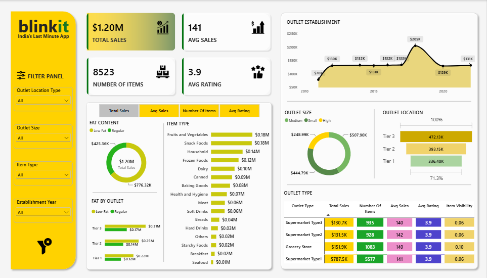

# 🛒 Blinkit Sales & Business Analysis

### End-to-end analysis in SQL · Python · Power BI


An end-to-end sales and business analysis project based on Blinkit grocery data, implemented with **SQL, Python, and Power BI**. It examines overall sales performance, product performance, outlet performance, customer ratings and item visibility through data cleaning, KPI analysis, exploratory analysis and interactive reporting.


[](powerbi/screenshots/blinkit_dashboard.png)

---

## 📌 Table of Contents
- [Project Overview](#project-overview)
- [Business Objectives](#business-objectives)
- [Key Performance Indicators](#key-performance-indicators)
- [Data Cleaning & Quality](#data-cleaning--quality)
- [SQL Scripts](#sql-scripts)
- [Analysis Covered](#analysis-covered)
- [Power BI Dashboard](#power-bi-dashboard)
- [Key Business Insights](#key-business-insights)
- [Business Recommendations](#business-recommendations)
- [Repository Structure](#repository-structure)
- [How to Reproduce](#how-to-reproduce)
- [Author](#author)

---

## Project Overview

This project analyzes Blinkit grocery sales data to identify key performance patterns across products and outlet characteristics. **The same business problem was analyzed independently with three tools**, which makes it possible to cross-check results:

| Tool | Role |
|---|---|
| **SQL** | Data cleaning, validation, KPI calculation and business analysis |
| **Python** | Data cleaning, exploratory data analysis and visualization |
| **Power BI** | Interactive dashboard development and business reporting |

## Business Objectives

- Evaluate overall sales performance
- Analyze sales by item fat content and item type
- Compare outlet performance by location, size, establishment year and type
- Monitor key business KPIs
- Analyze item visibility across outlet types
- Identify insights and potential optimization areas

## Key Performance Indicators

| KPI | Description |
|---|---|
| Total Sales | Overall sales generated across the dataset |
| Average Sales | Average sales per item record |
| Number of Items | Total number of item records analyzed |
| Average Rating | Average customer rating across items |

## Data Cleaning & Quality

- Data quality and missing-value validation
- Standardization of `Item Fat Content` categories
- Missing `Item Weight` treatment using a hierarchical imputation approach
- Duplicate and grain validation
- Categorical and numerical value validation

### Item Weight Imputation

Missing `Item Weight` values were handled with a two-level strategy:

1. Recover the weight from the same `Item Identifier` when a known value exists.
2. For the remaining cases, use the **median** weight within the matching `Item Type` and `Item Fat Content` group.

This preserves as much original information as possible and avoids a blanket mean-based replacement.

## SQL Scripts

| Script | Purpose |
|---|---|
| [`sql/01_Blinkit_Data_Cleaning.sql`](sql/01_Blinkit_Data_Cleaning.sql) | Data quality checks, standardization, missing-value treatment and validation |
| [`sql/02_Blinkit_Business_Analysis.sql`](sql/02_Blinkit_Business_Analysis.sql) | KPI calculation and business analysis queries |

Run the scripts in order (01, then 02).

## Analysis Covered

**Product analysis**
- Sales by Item Fat Content and by Item Type
- Top-performing item categories
- Average sales and ratings by product group

**Outlet analysis**
- Sales by Outlet Location Type, Size, Establishment Year and Type
- Average sales and ratings across outlet segments
- Average Item Visibility by Outlet Type

**Cross analysis**
- Sales by Item Fat Content across Outlet Location Types

## Power BI Dashboard

**Features:** KPI cards · interactive slicers · sales by fat content · item type performance · outlet establishment, size and location analysis · outlet-type performance matrix · item visibility analysis

[](powerbi/screenshots/blinkit_dashboard.png)

## Key Business Insights

| Finding | Value |
|---|---|
| Low Fat share of total sales | ≈ 64.6% |
| Highest-selling item category | Fruits and Vegetables (Snack Foods close behind) |
| Top outlet location tier | Tier 3 (≈ 39.3% of sales) |
| Top outlet size | Medium (≈ 42.3% of sales) |
| Strongest outlet type by sales | Supermarket Type1 |
| Item visibility | Highest at Grocery Stores, lowest at Supermarket Type3 |

> These findings are descriptive and reflect patterns in the analyzed dataset; they do not establish causal relationships.

## Business Recommendations

- Monitor demand and inventory availability for high-performing Low Fat product segments.
- Evaluate leading categories such as Fruits and Vegetables and Snack Foods further.
- Investigate the operational and financial characteristics of high-performing outlet formats such as Supermarket Type1.
- Evaluate medium-sized outlets for further operational and assortment analysis.
- Investigate differences in item visibility across outlet types and assess optimization opportunities.

## Repository Structure

```
blinkit-sales-business-analysis/
├── README.md
├── data/
├── sql/
│   ├── 01_Blinkit_Data_Cleaning.sql
│   └── 02_Blinkit_Business_Analysis.sql
├── python/
│   └── Blinkit_Analysis.ipynb
└── powerbi/
    ├── Blinkit_Analysis.pbix
    └── screenshots/
        └── blinkit_dashboard.png
```

## How to Reproduce

1. Place the dataset file in the `data/` folder.
2. **SQL:** load the data into your database, then run `01_Blinkit_Data_Cleaning.sql` followed by `02_Blinkit_Business_Analysis.sql`.
3. **Python:** `pip install pandas numpy matplotlib seaborn jupyter`, then open `python/Blinkit_Analysis.ipynb` and run all cells.
4. **Power BI:** open `powerbi/Blinkit_Analysis.pbix` in Power BI Desktop and update the data source if prompted.

## Author

**Abdelrahman Mohamed** · Data Analyst
[LinkedIn](https://www.linkedin.com/in/abdelrahman-abodeep) · [GitHub](https://github.com/Apodeep) · abdulrhmanapodeep@gmail.com
